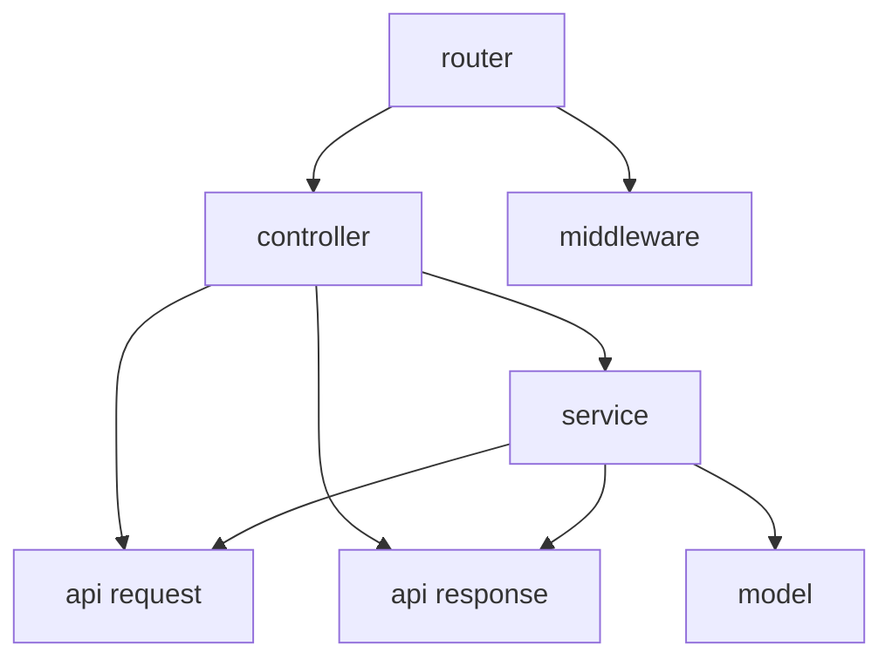

# MVC Layout

本目录用于说明 Go Web 应用的 MVC 分层布局。各目录代表职责边界；实际项目可以按规模增减文件，但应保持依赖方向清晰，避免循环依赖。

## 目录结构

```text
mvc-layout/
├── config/                  # 应用配置
├── internal/
│   ├── api/v1/
│   │   ├── request/         # API 请求结构
│   │   └── response/        # API 响应结构
│   ├── controller/          # 请求入口与响应编排
│   ├── middleware/          # HTTP 横切逻辑
│   ├── model/               # 领域及业务数据模型
│   ├── pkg/                 # 本应用内部复用组件
│   ├── repository/          # 数据持久化访问
│   ├── router/              # 路由注册与组装
│   └── service/             # 业务规则
├── scripts/                 # 构建、开发和运维脚本
├── tests/                   # 测试用例与测试辅助资源
└── web/                     # 前端静态资源
```

## 依赖关系



- `router` 负责把 URL、HTTP 方法、`controller` 处理函数和 `middleware` 组合起来，不承载业务规则。
- `controller` 处理 HTTP 请求边界：读取并校验请求、调用 `service`，再将结果组织为 API 响应。
- `service` 实现业务规则，可使用 `model` 和 API 的请求/响应类型；不直接处理 HTTP 请求或路由。
- `middleware` 提供认证、日志、恢复、限流等横切能力，不应反向依赖 `router` 或具体 `controller`。
- `model` 表达业务领域或持久化所需的数据，不依赖 HTTP/API 层类型。
- `repository` 封装数据库、缓存等访问。当前依赖图不规定它与 `service` 的接口组织方式；需要持久化时，应明确接口归属并避免让业务层绑定具体存储实现。
- API `request` / `response` 定义对外数据契约，与 `model` 分离；需要时由 `controller` 或 `service` 显式转换，避免把数据库模型直接暴露为 API。

依赖方向保持由入口和编排层指向被调用层，底层包不要反向导入上层包，也不要形成循环依赖。

## Reference

[wannanbigpig/gin-layout](https://github.com/wannanbigpig/gin-layout)